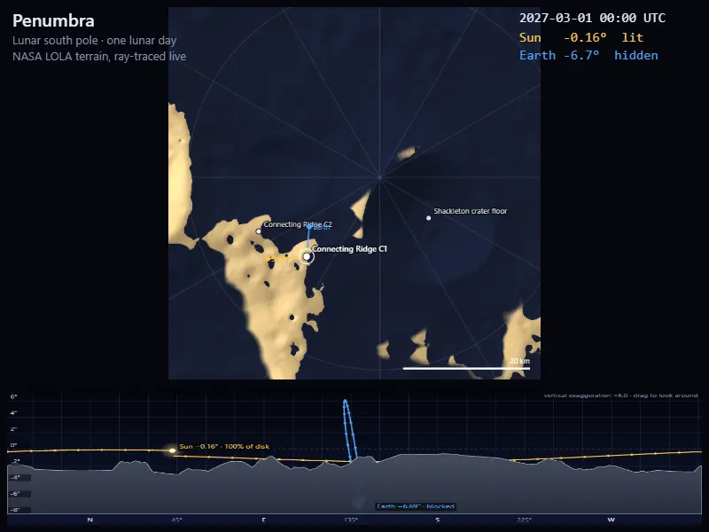
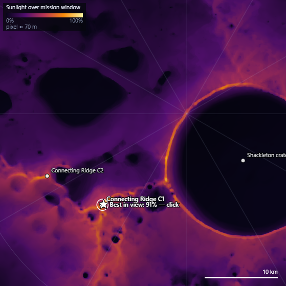
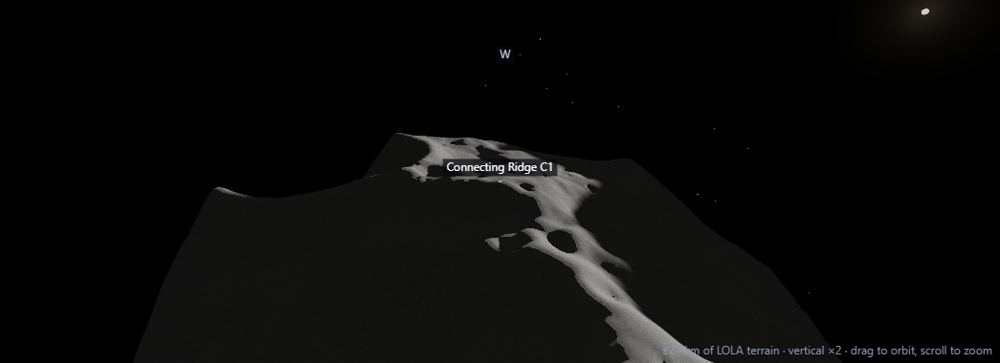
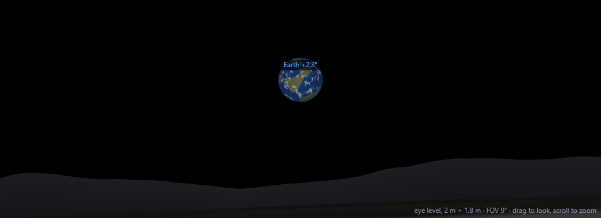
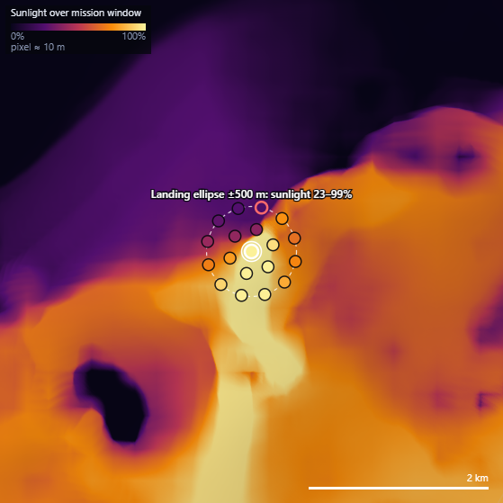
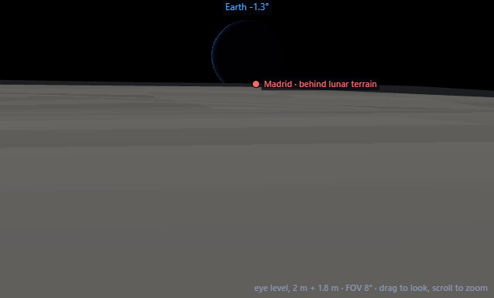
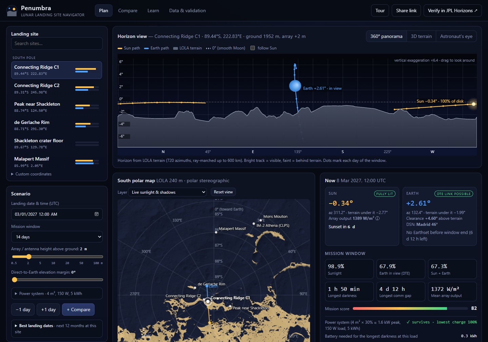

# Penumbra — Lunar Landing Site Navigator

[](https://github.com/ValtielCs/penumbra/actions/workflows/tests.yml) · **[Open the live app](https://valtielcs.github.io/penumbra/)**

**Compare lunar landing sites and dates in seconds: the Sun and the Earth above the *real* LOLA terrain horizon, with power and direct-to-Earth (DTE) windows — computed live in the browser and validated against NASA/JPL Horizons.**

NASA Space Apps Challenge 2026 · Challenge: *Lunar Landing Site Navigator* ·
[▶ 30-second demo video](https://valtielcs.github.io/penumbra/docs/penumbra-demo-30s.mp4) · [7-slide deck (PDF)](docs/Penumbra-demo.pdf)



| One-year sunlight map (GPU) | 3D terrain, real Sun | Astronaut's eye: Earth at true size & phase |
|---|---|---|
|  |  |  |



**Why a few hundred metres matter:** on Connecting Ridge in March 2027 (14-day mission), touchdown points of a ±500 m landing ellipse
receive between **23% and 99%** sunlight, and a CLPS-class battery survives the window at only **7 of 19** points. Each dot is a full
re-run of the mission, drawn over the GPU mission-window sunlight map; the colors agree because both engines agree.
Real landers do miss: in March 2025 IM-2 *Athena* came down on its side in a small crater about 250 m from its target near Mons Mouton,
and its mission ended the next day ([Spaceflight Now](https://spaceflightnow.com/2025/03/07/intuitive-machines-im-2-mission-ends-with-lander-on-its-side-on-the-moon/)).

<br clear="right">



**Which antenna can you reach?** A direct-to-Earth link needs a Deep Space Network antenna that sees the Moon *and* is itself in
line of sight of the site. From Mons Mouton at 02:00 UTC on 24 March 2027 the Earth's disk still rises above the ridge, but Madrid,
the only complex that sees the Moon, is already behind the lunar terrain: no link. Zoom in on the Earth in the astronaut's eye to see
the antennas (green: link, red: hidden by lunar terrain).

<br clear="right">



## Try it in 60 seconds

| | Scenario | What to look for |
|---|---|---|
| 1 | [Stand on Connecting Ridge and look at the Earth](https://valtielcs.github.io/penumbra/#site=c1&start=2027-01-08T00:00&days=7&t=2027-01-15T00:00&vm=eye&look=earth) | the Earth at true size and real phase, just above the ridges |
| 2 | [A year of sunlight around Shackleton](https://valtielcs.github.io/penumbra/#site=c1&start=2027-01-01T00:00&days=365.25&layer=3&mv=-6,-4,70) | rims of near-eternal light, crater floors in permanent shadow (GPU, 128 instants) |
| 3 | [Miss the target by 500 m](https://valtielcs.github.io/penumbra/#site=c1&start=2027-03-01T00:00&days=14&t=2027-03-08T12:00&ellipse=0.5) | 19 touchdown points: sunlight 23–99%, the battery survives at only 7 |
| 4 | [When to land on Mons Mouton](https://valtielcs.github.io/penumbra/#site=mou&start=2027-03-01T00:00&days=14&best=1) | 1 March ranks 335th of 365 days; July–November 2027 are perfect |
| 5 | [Which DSN antenna keeps the link](https://valtielcs.github.io/penumbra/#site=mou&start=2027-03-01T00:00&days=29.53&t=2027-03-24T02:00&vm=eye&look=earth) | Earth's centre is in view, but Madrid's antenna is behind the lunar terrain |
| 6 | [Check us against NASA/JPL Horizons](https://valtielcs.github.io/penumbra/#view=validate) | ≤ 9″ vs Horizons, ±0.3 points vs published illumination, two engines cross-checked |

## Why

At the lunar south pole the Sun never climbs more than ~1.6° above the horizon and the Earth bobs up and down by about ±7°.
Whether a lander has power or a radio link is decided by **terrain kilometres away**, and it changes within days
or a few hundred metres. Tools that answer this exist (Quickmap, Moon Trek, JPL Horizons), but each site-date
combination means several interfaces and raw tables. Penumbra puts the whole answer on one screen and lets you change
the site, the date or the array height and see the consequence immediately.

## What it does

| | |
|---|---|
| **Horizon view** | 360° panorama of the local LOLA terrain silhouette with the Sun and Earth tracks for the whole mission window, true angular sizes, Earth phase. Drag to look around; hover the ridge line to see *how far away* the terrain that sets the horizon is. |
| **Live shadow map** | South-polar LOLA map where every pixel ray-marches toward the Sun (or the Earth) on the GPU. Scrub time and watch the shadows sweep around the pole; switch to Earth visibility to see where DTE is possible. Click anywhere to analyse that spot. |
| **Mission-window maps** | *Sunlight %* and *Earth-in-view %* over the whole mission window: 128 instants averaged on the GPU in a fraction of a second. Peaks of near-eternal light and permanently shadowed craters pop out; ★ marks the best spot in view (click to analyse it). |
| **3D terrain & astronaut's eye** | ±24 km of LOLA terrain lit by the real Sun with the same ray-traced shadows, a far skyline from the horizon mask, and a sky with the true-size Sun and the Earth with its real phase. Orbit it, or stand at the site and look at the Earth: zoomed in, the Goldstone, Madrid and Canberra antennas appear on its disk, green when in line of sight. |
| **Linked horizon ↔ map** | Hover the skyline and the map traces the great circle to the ridge that sets the horizon at that azimuth, with its distance. Hover the map and the panorama marks where that spot sits in your sky. |
| **Off-target touchdown** | Landers miss their target by hundreds of metres. One click re-runs the whole mission window at 19 points of a ±250 m – ±5 km landing ellipse: ranges of sunlight, Earth visibility and darkness, how many points the battery survives, the best and worst touchdown, and “move the target to the best point”. |
| **Timeline** | Sunlight (visible fraction of the solar disk), Earth in view, both together, and Sun elevation vs. the terrain under it. Drag to scrub, ▶ to animate. |
| **Now panel** | Sun & Earth elevation/azimuth, array output (W/m²), **time to sunset / Earthset** (or sunrise / Earthrise), clearance above terrain. |
| **Mission window KPIs** | Sunlight %, Earth-in-view %, Sun + Earth %, longest darkness, longest comm gap, mean array output, battery needed for the longest darkness, flat vs. vertical panel. |
| **Power system & battery** | Array area, cell efficiency, load and battery (presets: rover, CLPS lander, habitat) → state-of-charge simulation over the window: *survives* or *battery empty on …*. |
| **Deep Space Network** | The Earth end of the link: a DTE link needs a DSN antenna (Goldstone, Madrid, Canberra) that sees the Moon above 10° **and** is itself in line of sight of the site. Seen from the south pole, Canberra sits ~0.5° above Earth's centre and Goldstone/Madrid ~0.5° below, so the Earth-centre shortcut overstates the link at Mons Mouton by 6 points (2027: 98.1% vs 91.8%). |
| **Schedule slip** | `−1 day / +1 day` buttons, `+ Compare` to stack scenarios side by side. |
| **Best landing dates** | Every landing day of the next 12 months at the selected site, ranked by the mission score with the same window metrics (sunlight, Earth, battery). The top five alternatives, a few days apart, and the rank of your current date; one click re-plans. |
| **When & where heatmap** | Every terrain-modelled site × every landing day of a year, colored by a mission score, sunlight, Earth visibility, both, the DSN antenna link or the battery. Click a cell to open that scenario. |
| **Learn** | Eight one-click lessons for educators and the public, with numbers computed live (why the Sun never climbs, why a mast matters, why the far side cannot call home, why landing on target matters…). |
| **Verify in JPL Horizons** | Opens the exact same Sun query (site, altitude, window) in the NASA/JPL Horizons API. |
| **Share link** | The URL encodes site, date, window, array height, time, map layer/view, power system and the whole comparison; a link reopens the exact scenario. |
| **Mission brief** | ⎙ A one-page printable summary of the scenario: parameters, KPIs, horizon/map/timeline snapshots, every darkness and loss-of-Earth period, the landing ellipse and a link back. Ctrl+P saves it as PDF for a review board. |
| **Tour, export, keyboard** | 45-second guided tour on first visit; CSV export of the time series and of the horizon mask; ←/→ (Shift = 1 day) to step through time; arrow keys, +/− and Enter on the map; live screen-reader summaries. |

Curated sites: Connecting Ridge C1/C2, Peak near Shackleton, de Gerlache Rim, Shackleton crater floor (PSR),
Malapert Massif, Mons Mouton, Nobile Rim 2 (Artemis III candidate regions; site DM2 from arXiv:2406.19863), IM-1 and IM-2 (CLPS), Chandrayaan-3 (ISRO), SLIM (JAXA),
Chang'e-4 (CNSA, far side), Apollo 11 and 17, plus any custom coordinates.

## How it works

1. **Ephemeris:** geocentric Sun and Moon from [Astronomy Engine](https://github.com/cosinekitty/astronomy) (MIT), rotated into the
   Moon-fixed Mean-Earth/Polar-Axis frame with the IAU rotation model of the Moon. That is the same frame as LOLA and Horizons' `MOON_ME`.
   One evaluation takes ~10 µs, so a year at 1-hour steps takes 0.1 s, offline. The Moon-fixed Sun/Earth vectors don't depend on the site,
   so one ephemeris pass serves every site in a comparison.
2. **Topocentric geometry:** azimuth/elevation at the site with the Earth's topocentric parallax (up to 0.26°). No refraction, because there is no atmosphere.
3. **Terrain horizon:** 720 great-circle rays marched through the LOLA DEM pyramid (240 m/px to 84°S, 960 m/px to 75°S) up to 600 km,
   with exact spherical geometry: `tan(elev) = ((R+h)cosθ − (R+hs)) / ((R+h)sinθ)`. Each ray stops early once even the highest summit
   on the map can no longer rise above the current horizon, so a full horizon takes ~15 ms. Terrain closer than 1.5 px (360 m) is not resolved by the DEM and is skipped.
4. **Power & comms:** sunlight = fraction of the true-size solar disk above the terrain line;
   array output = 1361 W/m² × (1 AU/r)² × visible fraction × cos(elevation) for a vertical Sun-tracking array;
   "Earth in view" = Earth's centre clears the terrain by the chosen margin; a DTE link also needs a DSN antenna above 10° that is in line of sight.
5. **GPU shadows:** a WebGL2 fragment shader marches each map pixel toward the Sun through the same DEM, with a soft penumbra from the solar disk.
   Window-average maps accumulate 128 instants into a float render target with additive blending; the 3D view reuses the same GLSL.
6. **DSN & battery:** topocentric Moon elevation at the three DSN complexes, and the line of sight from the lunar site to each antenna itself
   (an antenna sits up to 0.95° off Earth's centre as seen from the Moon); plus a simple energy balance of array, load and battery.
7. **Landing ellipse:** the same pipeline at 19 touchdown points (the target, 6 at r/2, 12 at r along great circles). Ephemeris samples are
   site-independent, so only the horizon and the series are recomputed: about 0.3 s for the whole ellipse.

## Validation

| Check | Result |
|---|---|
| Sun & Earth elevation vs **JPL Horizons** (surface observers on the Moon, 3 sites incl. Apollo 11 in 1969) | max error **≤ 9″** (0.0025°) |
| Sub-Earth & sub-solar points vs JPL Horizons, 1 year | max **≤ 29″** (0.008°) |
| 20-yr average illumination, Connecting Ridge C1 (Gläser et al. 2018: 88.0%) | **87.7%** |
| 20-yr average illumination, Connecting Ridge C2 (Gläser et al. 2018: 78.1%) | **78.0%** |
| Shackleton crater floor (permanently shadowed) | **0.0%** |
| GPU shadows vs CPU horizon engine, instant by instant: 10 sites × 40 instants of 2027 | lit/shadowed **400 / 400 agree**; visible solar disk within **0.083** |
| GPU mission-window maps vs CPU horizon engine, same point, same 128 instants of 2027, 10 sites | sunlight within **0.2 points**, Earth in view within **1 of 128 instants** |
| Line of sight from a lunar site to each DSN antenna vs an exact Astronomy Engine reference (ObserverVector + GeoMoon + IAU rotation) | **0.1″** |
| Terrain horizon on synthetic terrain with an analytic answer (smooth sphere from 100 m, 1 km ring wall at 20 km) | exact within the grid limits |
| Position sensitivity: 18 m from the de Gerlache rim site | one-year sunlight **64.6% → 68.7%** (why the landing-ellipse check exists) |

Reproduce with the scripts in [`tools/`](tools): `fetch-horizons.sh`, `validate-horizons.mjs`, `check-illumination.mjs` (Node.js),
and `validate-gpu.js` (paste into the browser console on a running Penumbra page).
Unit tests of the geometry and physics core (205 checks, no data download needed): `node tools/test-core.mjs`.

## Engineering

- **Two independent engines, cross-checked.** Per-pixel GPU ray-marching (maps, 3D) and CPU horizon masks (numbers) share one terrain model
  and agree on lit/shadowed in 400 of 400 test instants (see Validation).
- **Exact terrain on every GPU.** Heights stay 32-bit floats everywhere: hardware filtering where `OES_texture_float_linear` exists,
  otherwise bilinear interpolation in the shader (common on mobile GPUs; force it with `?gpu=manual`: same lit/shadowed agreement in a 360-instant test, ~13% slower).
  The previous half-float fallback would have shifted one-year sunlight by up to 0.8 points (Malapert Massif).
- **Never freezes the page.** The Compare heatmap (10 sites × 365 days of hourly geometry) and the Learn numbers are computed in steps
  that yield to the browser: both tabs open in under 0.1 s and fill in within ~0.5 s; the longest blocking step is ~0.14 s.
- **Fast physics.** Long windows evaluate the exact Sun/Earth geometry every 3 h and interpolate quadratically in between: within
  0.3″ of evaluating every sample (unit-tested), 3–20× faster. DSN visibility uses the Moon's geocentric position every 3 h plus exact
  Earth rotation and WGS84 station positions: within 0.003° of Astronomy Engine's full topocentric solution, 14× faster.
  Choosing a one-year window now takes ~0.17 s instead of ~0.64 s.
- **Fast first load.** `preload`/`modulepreload` hints start the 3.6 MB LOLA pyramid and every module in parallel with the HTML;
  both DEM levels download concurrently and are decoded with the native `DecompressionStream`.
- **Robust.** Share links are validated (a broken link falls back to defaults), History API writes are debounced (Firefox/Safari
  rate-limit them), WebGL context loss is recovered, GPU quality adapts to slow laptops, unexpected errors are reported in the UI.
- **Secure by default.** Strict Content-Security-Policy (only our own scripts, no `eval`, same-origin data), no third-party requests,
  no cookies or tracking; everything is static files.
- **Touch and keyboard.** Pinch-zoom on the map and in 3D, drag everywhere; keyboard control of the map, panorama and timeline,
  live screen-reader summaries, focus outlines, reduced-motion support.
- **Tested.** `node tools/test-core.mjs` (205 checks of the geometry/physics core) runs in GitHub Actions on every push, next to the
  validation scripts against JPL Horizons and the published illumination. `tools/check-links.mjs` checks every relative link and
  asset path letter-case-exactly, and `tools/pages-sim.py` serves the site the way GitHub Pages does (under `/<repo>/`, case-sensitive,
  without gitignored files) to test a deployment before publishing.

## NASA data & resources

- **LRO LOLA** gridded polar topography `LDEM_75S_240M` (PDS Geosciences Node), the terrain for every horizon and the shadow map.
- **NASA/JPL Horizons** (DE441, `MOON_ME`), the reference ephemerides used for validation and the in-app *Verify* link.
- **LROC / Quickmap** landing-site positions; **Moon Trek** as visual cross-reference.
- **NASA Deep Space Network** antenna locations (DSS-14, DSS-63, DSS-43) from the DSN Telecommunications Link Design Handbook 810-005.
- Space Agency Partners: ISRO (Chandrayaan-3), JAXA (SLIM) sites; CSA Moon Exploration portal.

## Run locally

```bash
python tools/serve.py 8787 .
```

Deep links: `#site=c1&start=2027-03-01T00:00&days=29.53&vm=eye&look=earth` (astronaut's eye, looking at the Earth),
`&layer=3&mv=-6,-4,70` (one-year sunlight map zoomed on Shackleton), `&ellipse=0.5` (run the ±500 m landing-ellipse check),
`&best=1` (rank the best landing dates), `&view=compare|learn|validate`, `?gpu=manual` (force the in-shader terrain sampling).

Then open http://127.0.0.1:8787. Any static server works; the app is plain HTML + ES modules with no build step.
Hosting on GitHub Pages: after `gh auth login`, `bash tools/publish.sh` creates the public repository, enables Pages for the root
folder and fills the live links into the slides and the submission text.

## Rebuild the data (optional)

```bash
# 1. LOLA DEM (29 MB) -> raw/lola/ldem_75s_240m.img (+ .lbl) from
#    https://pds-geosciences.wustl.edu/lro/lro-l-lola-3-rdr-v1/lrolol_1xxx/data/lola_gdr/polar/img/
node tools/build-dem.mjs raw/lola/ldem_75s_240m.img data/dem     # browser DEM pyramid (3.6 MB)
node tools/build-sites.mjs                                       # curated sites + 20-yr statistics
bash tools/fetch-horizons.sh raw/horizons                        # JPL Horizons reference tables
node tools/validate-horizons.mjs raw/horizons data/validation.json
node tools/check-illumination.mjs data/dem
```

## Project structure

```
index.html, css/app.css     UI shell
js/core/ephemeris.js        Sun/Earth geometry in the Moon-fixed frame, topocentric az/el
js/core/dem.js              LOLA DEM pyramid: decoding + bilinear sampling in polar stereographic
js/core/horizon.js          terrain horizon ray-marcher, disk occultation
js/core/analysis.js         power/comm time series, windows, sunset/Earthset times, KPIs
js/core/score.js            mission score policy (edit to match your mission)
js/core/dsn.js              Deep Space Network: Moon elevation at Goldstone, Madrid, Canberra
js/core/dispersion.js       landing ellipse: the mission re-run at 19 touchdown points
js/core/geo.js              great-circle destination / bearing on the lunar sphere
js/core/bestdates.js        every landing day of the next 12 months at one site, ranked (also the Compare heatmap rows)
js/ui/brief.js              printable one-page mission brief
js/ui/map.js                WebGL2 map: live shadows, window-average maps, best spot (+ shared terrain GLSL)
js/ui/view3d.js             WebGL2 3D terrain, skyline ring, physically placed Sun/Earth sky
js/ui/*.js                  panorama, timeline, compare/heatmap, learn, validation, tour
data/                       DEM pyramid, curated sites, validation results (formats: data/README.md)
tools/                      data pipeline & validation (Node.js, Python), screenshots, slides, hero animation
docs/                       screenshots, demo deck (Penumbra-demo.pdf ← slides.html), 30-s video (penumbra-demo-30s.mp4 ← video.html
                            + tools/encode-video.py), link-preview card (og-card.png ← og.html), hero animation
vendor/                     Astronomy Engine 2.1.19 (MIT)
```

## Limitations

- Terrain resolution is 240 m near the pole and 960 m beyond 84°S. Sharp ridge crests are smoothed, so we skip terrain
  closer than 360 m. Sites north of 75°S use a smooth-sphere horizon.
- DTE is a geometric line of sight to the Earth's center plus a DSN antenna above 10°; link budgets, antenna pointing and lunar relay satellites are out of scope.
- Power assumes a clean, vertical, Sun-tracking array (no thermal or dust effects).
- Landing-ellipse spreads below ~250 m are limited by the 240 m DEM (they reflect interpolated terrain, not real metre-scale relief).
- Near 75°S the horizon toward lower latitudes is truncated at the edge of the terrain model.

## Team

**42 WW** (Kazakhstan): Nikita Chesnokov (team owner) and Gleb Savelyev.

## Credits

Data: NASA LRO LOLA team (GSFC) via the PDS Geosciences Node; NASA/JPL Solar System Dynamics (Horizons); LROC (ASU).
Literature: Gläser et al. 2018 (PSS); Bussey et al. 2010 (Icarus). Library: Astronomy Engine by Don Cross (MIT).

**AI disclosure:** most of the code, the tests, the documentation, the slides and the demo video were written with an AI coding
assistant (Claude, Anthropic) under the team's direction. Every number shown is reproducible with the scripts in `tools/`, validated
against NASA/JPL Horizons and published illumination studies, and covered by unit tests in CI.
